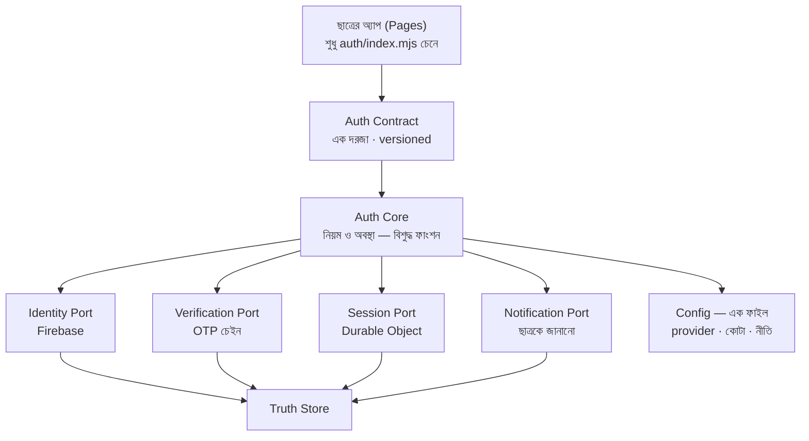
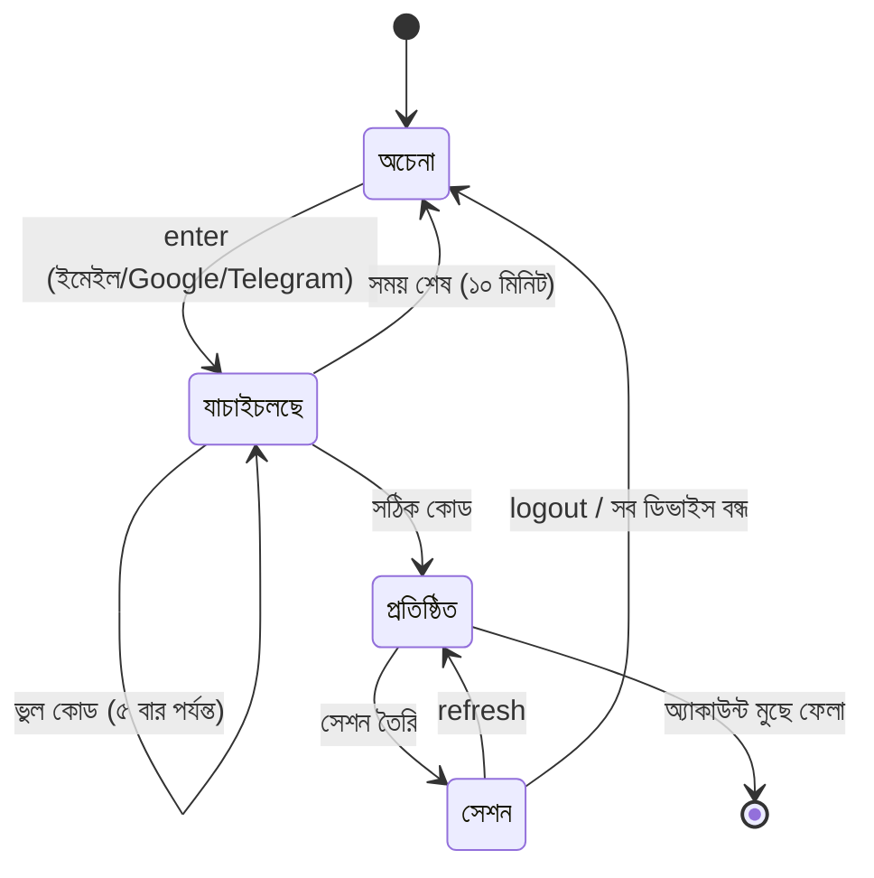

# AUTH V2 — পূর্ণ Signup/Signin আর্কিটেকচার ব্লুপ্রিন্ট

> **অবস্থা:** খসড়া v1.0 · **তারিখ:** ২০২৬-১০-৩১ · **মালিক:** Sheik Mohammad Rashel
> **রিপো:** `rashelmahmudpc-create/admissionsky` · **ভিত্তি:** ৫ জন এজেন্টের স্বাধীন কোড-অডিট (লাইভ + সোর্স প্রমাণ)
> **লক্ষ্য:** এমন auth কাঠামো যা **৪–৫ বছর** নীরবে টিকে থাকবে — নতুন ফিচার যোগ করলে ভাঙবে না, ছাত্র আটকাবে না, আর কোনো দিন "কোথায় কী আছে" খুঁজতে হবে না।

---

## ০. এক নজরে — কেন নতুন কিছু লাগছে

পুরনো সিস্টেম **কাজ করে**, কিন্তু তার সত্যতা তিন জায়গায় ছড়িয়ে আছে: Firebase (পরিচয়), Durable Object (সেশন+OTP), আর KV (guard)। অডিটে ধরা পড়েছে সমস্যাগুলো বাগ নয় — **কাঠামোর সমস্যা**: একই তথ্য দুই জায়গায়, একই UI দুইবার, আর যে চেকগুলো নিরাপত্তা দিচ্ছে বলে মনে হয় সেগুলোর অনেকগুলো আসলে শুধু লেখা মেলায়, আচরণ মেলায় না।

| # | মূল আবিষ্কার | প্রমাণ |
|---|---|---|
| ১ | auth Worker deploy হয় **bundle-যাচাই ছাড়াই** — অটো পথে `check:auth-worker-bundle` কখনো চলে না | deploy workflow-তে শুধু অ্যাপ bundle চেক |
| ২ | **`auth/` ফোল্ডারের ১০১৮ লাইনের ৬২টা টেস্ট** এমন কোড পরীক্ষা করে যা প্রোডাকশনে লোডই হয় না | কোনো production ফাইল `auth/` import করে না |
| ৩ | ছাত্রকে **নিরাপত্তা-নোটিফিকেশন কখনো যায় না** — sender হার্ডকোডে `null`, আর activation ডিফল্ট `dry-run` | authority constructor |
| ৪ | **সব নিরাপত্তা-অ্যালার্ট নীরবে হারায়** — caller await করে না, ব্যর্থতা `'failed'`-এ চুপ হয়ে যায় | handler-এর ৩ জায়গা + alerts module |
| ৫ | `/signup`-এ **user enumeration** — ইমেইল থাকলে 409, না থাকলে 202; অথচ `/password-reset` ইচ্ছে করে গোপন রাখে | handler-এর error mapping |
| ৬ | Telegram **verification**-এর সব UI কোডে আছে, লাইভে `available:false`, আর client-এ hard-wired `false` | config + client state |
| ৭ | Telegram resend-এর **১ সেকেন্ডের timer চিরকাল চলে** — ভিউ ছাড়ার সময় clear হয় না | client timer |
| ৮ | **দুইটা সম্পূর্ণ auth UI** পাশাপাশি — inline shell + আলাদা onboarding ফাইল, দুই সেট handler | ৪১২০ লাইন + ৬৭ KB |
| ৯ | pending-signup-এর rate-limit **transaction ছাড়া** read-modify-write — সমান্তরাল কলে গণনা হারায় | pending store |
| ১০ | ৩টা auth টেস্ট স্যুট **কখনো একবারও চলে না**, অথচ wiring-guard বলে "wired" | path filter-কে wiring গুনছে |

**সেশন ও স্টোরেজ স্তরে আরও যা ধরা পড়েছে:**

| # | মূল আবিষ্কার | প্রমাণ |
|---|---|---|
| ১১ | অ্যাকাউন্ট বন্ধ করলে **সেশন বাতিল হয়, কিন্তু চেনা-ডিভাইস থাকে** — ৩০ দিন ওই ডিভাইস OTP ছাড়াই ঢুকত | account-state লেখার জায়গায় শুধু session revoke |
| ১২ | **সেশন কখনো rotate হয় না** — পাসওয়ার্ড বদলালেও, privilege বাড়লেও একই টোকেন; আর **নিষ্ক্রিয়তার সময়সীমাই নেই** | শুধু `last_seen_at` লেখা হয়, তুলনা হয় না |
| ১৩ | **ছাত্রের ডিরেক্টরি স্কিমা পুরোটাই মৃত** — ৮টা টেবিল (`students`, `sessions`, `devices`, `profiles`…) প্রতিবার তৈরি হয়, অথচ কোনো production কোড ওতে লেখেই না | grep: লেখে শুধু নিজের টেস্ট ফাইল |
| ১৪ | **অ্যাকাউন্টের অবস্থা দুই জায়গায়** — `auth_users.status` আর `auth_account_state.status`; একটা কেউ লেখেই না, অথচ session-যাচাই ওটাই পড়ে | `UPDATE auth_users SET status` = শূন্য |
| ১৫ | **একটাই secret সব কাজ করে** — session ref, email ref, device ref, আর password vault-এর চাবি; তাই rotate করা কার্যত নিষিদ্ধ | এক env var, দুই কাজে |
| ১৬ | **"সব ইউজার মুছুন" অ্যাভাটার রেখে যায়** — wipe শুধু DO-র টেবিল দেখে, অ্যাভাটার আলাদা D1-এ | wipe enumerates DO tables only |
| ১৭ | **পরিচ্ছন্নতা থেমে যেতে পারে** — কিছু টেবিল খালি হলে alarm-ই সেট হয় না, তাই ৯০ দিনের পুরনো ঘটনা কখনো মুছে না | nextExpiry কয়েকটা টেবিলই দেখে |
| ১৮ | **অভ্যন্তরীণ route-এ caller যাচাই নেই** — DO-র `/internal/*` (wipe সহ) ডাকনেকারকেই বিশ্বাস করে; comment বলে "token-gated", কোডে নেই | comment বনাম কোড |

**OTP চেইনে আরও যা ধরা পড়েছে:**

| # | মূল আবিষ্কার | প্রমাণ |
|---|---|---|
| ১৯ | **গার্ড Turnstile না থাকলে খুলে যায়** — secret bind না থাকলে সাধারণ কলার সোজা ঢুকে যায়, শুধু datacenter ASN আটকায়। `TURNSTILE_SECRET_KEY` wrangler-এ নেই, তাই প্রোডাকশনে L4 সত্যিই চালু কি না **অযাচাই** | guard module + wrangler grep |
| ২০ | **পরিচ্ছন্নতা-পরিষেবা `half-open`-এ আটকে থাকতে পারে** — USER-শ্রেণির ব্যর্থতায় circuit ছোঁয়াই হয় না, তাই একটা আটকে-যাওয়া slot **প্রতিটা অনুরোধে সবার আগে** চেষ্টা হয় | repository-র circuit আপডেট |
| ২১ | **ডাবল-SEND সম্ভব, অথচ comment বলে "কখনো দুইবার নয়"** — timeout হলে `providerAccepted=false` ধরে পরের slot-এ যায়, অথচ আগেরটা গ্রহণ করে থাকতে পারে | orchestrator loop |
| ২২ | **admin panel আংশিক সেভ করলে বাকি slot নীরবে বন্ধ** — প্যানেল যে slot পাঠায় না, সেটা `enabled:false` হয়ে যায় | config merge |
| ২৩ | **`verify()`-এর নিজের বাজেট নেই** — send পথ ২৫ সেকেন্ড মানে, কিন্তু verify ২০ সেকেন্ড পর্যন্ত টানতে পারে | orchestrator |
| ২৪ | **একটা GET পথে unbounded তৃতীয়-পক্ষ কল** — Telegram API আটকে গেলে অনুরোধ অনির্দিষ্টকাল ঝুলে থাকে | orchestrator |
| ২৫ | **প্রমাণের অভাব লুকিয়ে থাকে** — `liveDeliveryVerified` কখনো `true` হয় না, তাই অ্যাডমিন proven আর unproven slot আলাদা করতে পারে না | providers |

**সারকথা:** সমস্যা অজ্ঞতা নয়, **ছড়িয়ে থাকা**। তাই V2-এর পুরো দর্শন এক লাইনে — *এক তথ্য, এক জায়গা, এক পথ।*

---

## ১. নকশার সাতটা স্তম্ভ

প্রতিটা সিদ্ধান্ত এই সাতটা দিয়ে মাপা হবে। কোনো PR এগুলোর একটাও ভাঙলে সেটা merge হবে না।

**১️⃣ এক সত্যের উৎস (Single Source of Truth)**
প্রতিটা তথ্যের একটাই ঘর। provider-ক্রম, কোটা, সেশন-নীতি — সব এক ফাইলে, কোড হিসেবে। deploy-এর সময়ের বদল কখনো চুপচাপ হারাবে না, কারণ রাখার দ্বিতীয় জায়গাই নেই।

**২️⃣ ইন্টারফেস আগে, বাস্তবায়ন পরে**
`auth/index.mjs` একটাই দরজা। বাকি অ্যাপ শুধু এই চুক্তি দেখে। ভেতরে Firebase বদলালে, provider বদলালে, এমনকি Worker ভাগ করলেও ছাত্রের অ্যাপ কিছু জানে না।

**৩️⃣ ছাত্রকে কখনো অর্ধেক অবস্থায় ফেলা যাবে না**
হয় পুরোটা হলো, নয় কিছুই হলো না। "অ্যাকাউন্ট হয়েছে কিন্তু যাচাই করা যায় না" — এমন অবস্থা কাঠামোগতভাবে অসম্ভব হবে।

**৪️⃣ ব্যর্থতা অবশ্যই দেখা যাবে**
নীরব `catch {}` নিষিদ্ধ। প্রতিটা ব্যর্থতা হয় লগে, নয় অ্যালার্টে, নয় দুটোতেই — কোনোটায় না থাকা চলবে না।

**৫️⃣ যাচাই আচরণ মাপে, লেখা নয়**
"ফাইলে এই লাইন আছে" — এটা টেস্ট নয়। টেস্ট ছাত্রের কাজ নকল করবে আর ফল মাপবে।

**৬️⃣ ধীরে, উল্টানো যায় এমন ধাপে বদল**
প্রতিটা ধাপ আলাদা PR, পেছনে flag, আর এক ধাপেই আগের অবস্থায় ফেরা যায়।

**৭️⃣ সরলতাই নিরাপত্তা**
২৭টা provider slot, ৬০+ endpoint, ৪১২০ লাইনের ফাইল — এগুলো নিজেই ঝুঁকি। যা প্রমাণিত নয়, যা মাপা হয়নি, তা বাইরে।

---

## ২. লক্ষ্য কাঠামো

### ২.১ স্তরগুলো



**নিয়ম:** তীর শুধু নিচের দিকে। Core কখনো অ্যাপের কথা জানে না; অ্যাপ কখনো Firebase-এর নাম জানে না।

### ২.২ ফোল্ডার কাঠামো (লক্ষ্য)

```
auth/
  index.mjs              ← একমাত্র দরজা, versioned contract
  core/
    state-machine.mjs    ← অবস্থার পরিবর্তন, এক টেবিলে
    policy.mjs           ← নিয়ম (কত বার, কত ক্ষণ, কে পারবে)
    errors.mjs           ← এক তালিকা, এক ভাষা
  ports/
    identity.mjs         ← interface + Firebase বাস্তবায়ন
    verification.mjs     ← interface + OTP চেইন
    session.mjs          ← interface + DO
    notify.mjs           ← interface + email/telegram
  config/
    providers.mjs        ← এক জায়গা: ক্রম, কোটা, key-লাগে কিনা
  http/
    routes.mjs           ← ~২০টা route (৬০+ নয়)
    guards.mjs           ← honeypot → turnstile → rate, এক পথ
```

**সীমা:** কোনো ফাইল **৩০০ লাইনের বেশি নয়**। কোনো ফোল্ডারে **১৫টার বেশি ফাইল নয়**। এটা শৈলী নয় — এটাই ৪ বছরে ফাইলটা পড়ার যোগ্য রাখার একমাত্র উপায়।

### ২.৩ Endpoint — ৬০-এর বেশি থেকে ২০

| এখন (৬০+) | V2 (২০) | কেন |
|---|---|---|
| `/signup`, `/login`, `/google`, `/facebook`, `/telegram/login`, `/passkey/*` (৬) | `POST /auth/enter` + `POST /auth/complete` | একটাই প্রবেশ-দ্বার, পদ্ধতি ভেতরে |
| `/email-ownership/*` (৩), `/account-verification/*` (২), `/telegram/verification/*` (৪), `/verification/resend` | `POST /verify/start` · `POST /verify/check` · `GET /verify/state` | চারটা ভিন্ন নাম, একই কাজ |
| `/session`, `/session/logout`, `/logout-all` | `GET /session` · `POST /session/end` | এক জোড়া |
| `/security/*` (৫), `/profile/*` (৪), `/admin/*` (৬) | `/me` · `/me/security` · `/admin/*` (৩) | ছাত্র-ডেটা এক জায়গায় |
| `/config` | `/config` (থাকবে) | ক্লায়েন্ট চুক্তি |
| বাকি (webhook, canary, internal) | অপরিবর্তিত — কিন্তু `/internal/*` prefix বাধ্যতামূলক | পাবলিক আর অভ্যন্তরীণ আর মিশবে না |

**⚠️ যা ইচ্ছে করে বাদ:** Telegram *verification* (লগইন নয়) — স্যার ২০২৬-১০-৩১-এ "দরকার নেই" বলেছেন। কোড মুছব না, শুধু চেইন থেকে বাদ দিয়ে আলাদা ফাইলে সরিয়ে রাখব, যাতে একদিন চাইলে ফেরানো যায়।

---

## ৩. ছাত্রের যাত্রা — এক পথ, চার অবস্থা



**সোনার নিয়ম:** `প্রতিষ্ঠিত` অবস্থায় পৌঁছানোর আগে **Firebase-এ কোনো অ্যাকাউন্টই তৈরি হয় না**। আজ এটা অপশনাল (header লাগে); V2-তে এটাই একমাত্র পথ।

**চারটা অবস্থা, প্রতিটির একটাই অর্থ:**

| অবস্থা | মানে | ছাত্র যা দেখে |
|---|---|---|
| **অচেনা** | কোনো পরিচয় নেই | welcome স্ক্রিন |
| **যাচাইচলছে** | পরিচয় দাবি করা, প্রমাণ বাকি | কোড লেখার স্ক্রিন + countdown |
| **প্রতিষ্ঠিত** | পরিচয় প্রমাণিত, সেশন নেই | প্রোফাইল সেটআপ |
| **সেশন** | পুরো ঢুকেছে | ড্যাশবোর্ড |

**যেকোনো অবস্থা থেকে যেকোনো অবস্থায় যাওয়ার নিয়ম এক টেবিলে** (`core/state-machine.mjs`)। টেবিলে না থাকা переход অসম্ভব — কোডে আর কখনো "এই জায়গায় এটা হলে কী হবে" ভাবতে হবে না।

---

## ৪. সিদ্ধান্তের তালিকা

### ৪.১ পরিচয় — কে ছাত্র

**সিদ্ধান্ত:** Firebase থাকবে পরিচয় ও পাসওয়ার্ডের একমাত্র মূল। অ্যাপের ডেটা (`students` directory) আলাদা থাকবে, `firebase_uid` দিয়ে জোড়া।

**কারণ:** Firebase নিজে থেকেই পাসওয়ার্ড হ্যাশিং, rate-limit, breach-চেক, MFA সামলায় — এগুলো নিজে লিখলে ৪ বছরে অনেক ভুল হবে। আর ডেটা আলাদা রাখলে একদিন Firebase বদলানো গেলেও ছাত্রের পড়ার ইতিহাস অটুট থাকে।

**সীমা:** Firebase-এর কোনো SDK ছাত্রের ব্রাউজারে যাবে না। সব Firebase কল Worker থেকে — তাতে key, quota আর আচরণ তিনটাই আমাদের হাতে।

### ৪.২ Provider চেইন — ২৭ থেকে ৩

**সিদ্ধান্ত:** শুধু **প্রমাণিত** provider রাখা হবে। প্রমাণ মানে — লাইভে মেইল সত্যিই পৌঁছেছে, স্যারের নিজের inbox-এ দেখা গেছে।

| স্তর | Provider | কেন |
|---|---|---|
| ১ | **Brevo** | ছাত্রের inbox-এ প্রমাণিত, আসল slot |
| ২ | **Authgear** | key লাগে না, Inbox-এ প্রমাণিত, প্রতিদিন লাইভ probe চলে |
| ৩ | **Logto** | non-Gmail ছাত্রের জন্য দরকারি, প্রমাণিত ক্রম |
| — | বাকি ২৪টা | কোড থেকে **মুছে ফেলা হবে**, শুধু নয় বন্ধ করা |

**আজকের চেইনের সত্য অবস্থা (অডিটে মাপা):**

- মোট **২৭টা slot, ২৬টা চালু** — কিন্তু **১৪টার কোনো delivery প্রমাণ নেই, কোনো মাপও নেই**
- `whatsapp` slot-এর config row-ই নেই — **কখনো চলে না**, অথচ কোডে আছে
- pool ও IdP slot-গুলো শুধু `OTP_RAW`/`OTP_IDP` bind থাকলে তৈরি হয়; না থাকলে **নীরবে অচল** হয়ে যায়
- `liveDeliveryVerified` কখনো `true` হয় না — তাই proven আর unproven আলাদা করার উপায়ই নেই

**কারণ:** ২৪টা অচেনা provider মানে ২৪টা অজানা ব্যর্থতার জায়গা, ২৪টা key যার অনেকগুলো নেই, আর এমন কনফিগ যার ক্রম কেউ মনে রাখে না। **যা মাপা হয়নি, তা নিরাপত্তাও নয়, সুবিধাও নয় — শুধু ঝুঁকি।** দরকার হলে একদিন একটা যোগ করা যাবে, কিন্তু সেটা তখন প্রমাণ করে যোগ হবে।

**⚠️ আজকের ফাঁদ যা V2-তে থাকবে না:** provider-ক্রম দুই জায়গায় (ফাইল + Durable Object row)। একবার row সেভ হলে deploy-এর বদল হারিয়ে যায়। V2-তে ক্রম শুধু কোডে; DO শুধু *ফলাফল* রাখবে, *নিয়ম* নয়।

**⚠️ আরও দুই ফাঁদ:** admin panel আংশিক সেভ করলে যে slot পাঠানো হয়নি সেটা **নীরবে বন্ধ** হয়ে যায়; আর একটা `half-open` circuit আটকে থাকলে **প্রতিটা অনুরোধে সবার আগে** ওই মরা slot-ই চেষ্টা হয়।

### ৪.৩ নিরাপত্তা-স্তর — এক পথ, কোনো ফাঁক নেই

**সিদ্ধান্ত:** প্রতিটা পাবলিক endpoint **একই গার্ড-পথ** দিয়ে যাবে, ব্যতিক্রম ছাড়া।

```
অনুরোধ → honeypot (চুপচাপ 202) → turnstile → হার-সীমা → হ্যান্ডলার
```

**কারণ:** আজ `guardSend` আছে ৭টা জায়গায়, কিন্তু `/google/link` আর `/facebook`-এ নেই — অর্থাৎ password-guessing শুধু rate-limit-এর ভরসায়। **একটাই গার্ড-ফাংশন, সব route-এ** — নতুন route যোগ করলে গার্ড নিজে থেকেই লাগবে, ভুলে যাওয়ার সুযোগই থাকবে না।

**সঙ্গে যা বদলাবে:**
- `/signup`-এ enumeration বন্ধ — ইমেইল থাকুক বা না থাকুক, **হুবহু একই উত্তর**। `/password-reset` যেভাবে করে, `/signup`-ও তাই করবে।
- pending-store-এর rate-limit **transaction-এ** যাবে — সমান্তরাল কলে আর গণনা হারাবে না।
- সেশন বাতিলের সাথে **সব সংলগ্ন অবস্থা** একসাথে বাতিল — আজকের শুধু-session-বাতিল করার ফাঁদ আর থাকবে না।

### ৪.৪ নিরাপত্তা-নোটিফিকেশন — ছাত্র সত্যিই জানবে

**সিদ্ধান্ত:** পাসওয়ার্ড বদল, নতুন ডিভাইস থেকে লগইন, সন্দেহজনক চেষ্টা — এই তিনটায় ছাত্র **সত্যিই মেইল পাবে**।

**কারণ:** আজ sender হার্ডকোডে `null` আর activation `dry-run` — অর্থাৎ ফিচারটা আছে শুধু নামে। নিরাপত্তার খবর না পৌঁছালে সেটা নিরাপত্তা নয়, শুধু কোড। V2-তে এটা **এক পথে** যাবে, আর একটা টেস্ট প্রমাণ করবে মেইল বেরিয়েছে।

### ৪.৫ সেশন — এক জায়গা, স্পষ্ট নিয়ম

**সিদ্ধান্ত:** সেশন শুধু Durable Object-এ। Cookie হবে `__Host-` prefix সহ, HttpOnly, Secure, SameSite=Lax। সর্বোচ্চ আয়ু ৩০ দিন, নিষ্ক্রিয় ১৪ দিনে শেষ।

| নিয়ম | মান |
|---|---|
| তৈরি | শুধু `প্রতিষ্ঠিত` অবস্থায় |
| আয়ু | ৩০ দিন সর্বোচ্চ, ১৪ দিন নিষ্ক্রিয়তায় শেষ |
| refresh | single-flight — একই সময়ে ১০টা ট্যাব খুললেও একবার |
| privilege বদল | পাসওয়ার্ড বদল বা re-link-এ session **rotate** |
| বাতিল | session + device-trust + pending ticket — তিনটাই একসাথে |
| offline | ক্লায়েন্ট "লগইন আছি" **ধরে নেবে না** — সার্ভার নিশ্চিত না করলে দেখাবে না |

**দুটো নিয়ম আজ কোডে নেই, কিন্তু ৪ বছরে সবচেয়ে বেশি কাজে দেবে:**

- **rotate:** আজ সেশন টোকেন একবার তৈরি হয়ে চিরকাল একই থাকে। পাসওয়ার্ড বদলালে, নতুন ডিভাইস trust করলে, বা step-up শেষ হলে টোকেন **নতুন হবে**, পুরনোটা সাথে সাথে মৃত। নইলে একটা ফাঁস হওয়া cookie ৩০ দিন সমান শক্তিশালী থাকে।
- **নিষ্ক্রিয়তার সময়সীমা:** আজ শুধু পরম ৩০ দিন দেখা হয় — কেউ ৩ সপ্তাহ ব্যবহার না করলেও cookie পুরো বৈধ। V2-তে ১৪ দিন নিষ্ক্রিয় থাকলে সেশন শেষ।

**অ্যাকাউন্ট অবস্থার এক উৎস:** আজ দুই টেবিলে দুই `status`। V2-তে একটাই — আর **যে কোনো কারণে অ্যাকাউন্ট অব্যবহারযোগ্য হলে সেশন *আর* চেনা-ডিভাইস দুটোই একসাথে বাতিল** (আজ শুধু সেশন হয়, তাই বন্ধ করা অ্যাকাউন্টের ডিভাইস ৩০ দিন OTP ছাড়াই ঢুকত)।

**ডিভাইস-cookie:** আজ `__Host-ah_device` ৩৬৫ দিন বাঁচে, অথচ trust ৩০ দিন — ক্লায়েন্ট উল্টোটা বিশ্বাস করায়। V2-তে cookie-আয়ু আর trust-আয়ু এক হবে, আর logout-এ cookie-ও মুছবে।

**শেষ নিয়মটা গুরুত্বপূর্ণ:** আজ ছাত্র নেট ছাড়া থাকলে ক্লায়েন্ট নিজের মনে করে "সক্রিয়" দেখায়, অথচ সার্ভারে সেশন শেষ। এতে ছাত্র বিভ্রান্ত হয়, আর নিরাপত্তার দিক থেকে দুইটা আলাদা সত্য তৈরি হয়।

### ৪.৬ Client — এক UI, এক ভাষা-ব্যবস্থা

**সিদ্ধান্ত:** **দুইটা auth UI থাকবে না।** `sky-onboarding.js` আর inline shell — একটাই থাকবে, স্ক্রিন-প্রতি-ফাইল ভাগ করা।

```
ui/
  shell.mjs        ← কাঠামো ও রাউটিং
  screens/
    welcome.mjs · enter.mjs · verify.mjs · profile.mjs · security.mjs
  i18n/
    bn.mjs · en.mjs   ← সব লেখা এক জায়গায়, কোডে কোনো লেখা নেই
  timer.mjs        ← ভিউ-আয়ুতে বাঁধা timer (leak অসম্ভব)
```

**কারণ:** আজ প্রতিটা স্ক্রিন দুইবার লেখা — একবার inline, একবার string-এ। একটা লেখা বদলাতে দুই জায়গায় হাত দিতে হয়, না দিলে দুই পথ আলাদা হয়ে যায়। আর timer ভিউ-আয়ুতে বাঁধা না থাকায় ছাত্র ভিউ ছাড়লেও ঘণ্টার পর ঘণ্টা চলে।

**সঙ্গে:** সব লেখা `i18n`-এ — আজ `setWelcomeLanguage` শুধু `[data-bn][data-en]` নোড বদলায়, তাই ইংরেজি বেছে নিলেও অর্ধেক স্ক্রিন বাংলাই থাকে।

---

## ৫. যা একদম বদলাবে না

নতুন কাঠামোতে এগুলো **হুবহু বহন** করতে হবে — এগুলোই আজকের আসল সম্পদ:

- **HMAC-ঘটিত reference + constant-time তুলনা** — টোকেন কোথাও কাঁচা অবস্থায় থাকে না; সেশন টোকেন ২৫৬-বিট random, শুধু HMAC-ref সংরক্ষিত
- **Password vault** — pending অবস্থায় পাসওয়ার্ড সিল করা থাকে, response-এ কখনো আসে না
- **Transactional session establish** — সংঘাত ধরা পড়ে, `INSERT OR IGNORE`-এ অ্যাকাউন্ট পুনরায় তৈরি হয় না
- **Honeypot-এর অভিন্ন 202** — বট আর ছাত্রকে আলাদা করা যায় না
- **Turnstile fail-closed** — secret বাঁধা থাকলে guard কখনো খোলে না
- **`claimsAuthPath`** — এক predicate, সব জায়গায় একই উত্তর (এটাই বাকি কোডের আদর্শ)
- **zero-storage invariant** — ব্রাউজারে কোনো টোকেন নেই
- **24 KB streaming body cap** আর **account state-machine transition table**
- **`check:worker-bundle`** — byte-for-byte তুলনা, রেপোর সবচেয়ে শক্ত চেক
- **otp-liveness-daily** — marker আগে লেখা, তাই আটকে গেলেও দিনে ১৪৪০ মেইল যায় না
- **Fail-safe নিরাপত্তা নীতি** — খারাপ override ফিরে যায় ফ্রোজেন ডিফল্টে; ঝুঁকি-মূল্যায়ন কখনো নীরবে "পাস" দেয় না
- **পাসওয়ার্ড এই কোডবেসে আসেই না** — হ্যাশিং Firebase-এর হাতে; `password-guard` শুধু lockout, আর সঠিক অনুমানেও lockout মোচন হয় না
- **অ্যাডিট-যুক্ত, transition-যাচাই করা account-state** — logout-all-এর ফিক্স (session + device একসাথে) যেভাবে হয়েছিল, V2-তে সেটাই সব জায়গায়
- **Additive, versioned migration** — চাহিদা-ভিত্তিক কলাম যোগ, idempotent

---

## ৬. রূপান্তরের ধাপ — প্রতিটা উল্টানো যায়

প্রতিটা ধাপ আলাদা PR, পেছনে flag, আর এক ধাপেই ফেরত যাওয়া যায়।

| ধাপ | কাজ | শেষ হওয়ার শর্ত | ফেরার পথ |
|---|---|---|---|
| **V2.0** | **নিরাপত্তা-ফাঁক বন্ধ** (নতুন কাঠামো নয়) | auth bundle deploy-এ যাচাই · ৩টা অচল স্যুট চালু · enumeration বন্ধ · `guardSend` সব route-এ · pending rate-limit transaction-এ · অ্যাকাউন্ট বন্ধে device-trust-ও বাতিল · Turnstile না-বাঁধা থাকলে **fail-closed** · circuit `half-open`-এ আটকাবে না · admin আংশিক সেভে slot বন্ধ হবে না · `verify()`-ও ২৫ সেকেন্ড বাজেটে | প্রতিটা আলাদা revert |
| **V2.1** | **আসল টেস্ট** | "লেখা মেলে" টেস্টগুলো আচরণ-টেস্টে বদল · নিরাপত্তা-নোটিফিকেশনের sender সত্যিই বসানো | পুরনো টেস্ট ফাইল ফেরত |
| **V2.2** | **Contract প্রথম** | `auth/index.mjs` লেখা হয়, কিন্তু কেউ ডাকে না · দুই বাস্তবায়ন পাশাপাশি চলে · আচরণ হুবহু মিলতে হবে | নতুন ফোল্ডার মুছে ফেলা |
| **V2.3** | **Endpoint একীকরণ** | ৬০+ → ২০ · প্রতিটা মুছে ফেলা route-এর জন্য এক লাইন redirect · ক্লায়েন্ট নতুন পথে | পুরনো route ফেরত |
| **V2.4** | **Provider ছাঁটা** | ২৭ → ৩ · বাদ পড়াগুলো কোড থেকে মুছে ফেলা · ফেইলওভার টেস্ট প্রমাণ করে ছাত্র আটকায় না | git revert |
| **V2.5** | **Client একীকরণ** | দুই UI → এক · i18n এক জায়গায় · timer ভিউ-আয়ুতে বাঁধা | পুরনো ফাইল ফেরত |
| **V2.6** | **ডেটা একীকরণ** | মৃত ৮ টেবিলের স্কিমা মুছে ফেলা · অ্যাকাউন্ট-অবস্থা এক টেবিলে · wipe-এ অ্যাভাটারও যায় · alarm-chain সবসময় চলে | স্কিমা ফাইল ফেরত |
| **V2.7** | **চাবি আলাদা** | HMAC-এর কাজ আলাদা, vault-এর চাবি আলাদা — একদিন rotate করা সম্ভব হয় · `/internal/*`-এ caller যাচাই | env var ফেরত |
| **V2.8** | **পরিষ্কার** | `auth/` (১০১৮ লাইন, unmounted) মুছে ফেলা · মৃত flag মুছে ফেলা · ডক হালনাগাদ | git revert |

**ক্রমের কারণ:** আগে **নিরাপত্তা ও সত্য মাপা** (V2.0–V2.1), তারপর **কাঠামো** (V2.2–V2.3), শেষে **ছাঁটা, একীকরণ ও পরিষ্কার** (V2.4–V2.8)। উল্টো করলে নতুন কাঠামোও পুরনো মিথ্যার উপর দাঁড়াবে।

---

## ৭. টেস্ট কৌশল — আচরণ, লেখা নয়

**সোনার নিয়ম:** একটা টেস্ট ফেল করলে যেন **ছাত্রের কিছু খারাপ হয়** — নইলে টেস্টটা টেস্ট নয়।

| স্তর | কী মাপে | উদাহরণ |
|---|---|---|
| **চুক্তি** | ইন্টারফেস অটুট | `auth/index.mjs`-এর বাইরে কেউ Firebase ছোঁয় না — grep দিয়ে প্রমাণ |
| **আচরণ** | ছাত্রের যাত্রা | signup → কোড → ড্যাশবোর্ড, নকল provider দিয়ে, সময় নিয়ন্ত্রিত |
| **সংঘাত** | একসাথে দুই ক্লিক | সমান্তরাল begin → একটাই ticket, একটাই অ্যাকাউন্ট |
| **ব্যর্থতা** | provider মরে গেলে | সব provider বন্ধ → ছাত্র আটকায় না, কারণ নাম ধরে বলে |
| **নিরাপত্তা** | আক্রমণ প্রতিরোধ | enumeration, brute-force, replay, session hijack |

**যা নিষিদ্ধ:**
- `assert.match(source, /.../)` — সোর্স লেখা মেলানো
- ডক-ফাইলের prose-এর উপর assertion
- Mock সার্ভারের উপর দাঁড়ানো "লাইভ" অডিট
- path filter-কে "wired" গোনা

**বাধ্যতামূলক:** যে স্যুট auth ছোঁবে, তার নাম **প্রকৃত workflow-এ** থাকতে হবে — path filter-এ নয়।

---

## ৮. ৪–৫ বছরের নিশ্চয়তা — কীভাবে টিকবে

| ঝুঁকি | আজ | V2-তে |
|---|---|---|
| **কেউ ভুলে গার্ড না বসায়** | route-প্রতি হাতে | এক গার্ড-পথ, নতুন route-এ নিজে থেকে |
| **দুই জায়গার কনফিগ আলাদা হয়** | provider ক্রম দুই জায়গায় | শুধু কোডে, DO-তে নিয়ম নেই |
| **UI দুই পথে ভাগ হয়** | দুইটা UI | এক UI, স্ক্রিন-প্রতি-ফাইল |
| **ফাইল পড়ার অযোগ্য হয়** | ৪১২০ + ২৫০৩ + ২৩৫১ লাইন | সর্বোচ্চ ৩০০ লাইন |
| **চেক আছে কিন্তু চলে না** | ৩টা স্যুট অচল, bundle-চেক বাদ | প্রতিটা স্যুট প্রকৃত workflow-এ |
| **টেস্ট পাস করে কোড ভাঙা** | লেখা মেলায় | আচরণ মাপে |
| **নীরব ব্যর্থতা** | ৩৩টা খালি `catch` | লগ বা অ্যালার্ট বাধ্যতামূলক |
| **ছাত্র আটকে যায়** | Telegram-এ অর্ধেক অ্যাকাউন্ট | অর্ধেক অবস্থা কাঠামোগতভাবে অসম্ভব |
| **প্রদানকারী মরে যায়** | ২৪টা অজানা, ১৪টা অমাপা | ৩টা প্রমাণিত + failover টেস্ট |
| **একটা চাবি ফাঁস হলে সব যায়** | এক secret-এ session + vault | আলাদা চাবি, তাই rotate করা সম্ভব |
| **ফাঁস হওয়া cookie চিরকাল চলে** | ৩০ দিন rotate ছাড়াই | privilege বদলে rotate + ১৪ দিন নিষ্ক্রিয়তায় শেষ |
| **খালি টেবিল জমতে থাকে** | alarm থেমে যেতে পারে | পরিচ্ছন্নতা সবসময় চলে, মাপা হয় |
| **মৃত স্কিমা ভুল বোঝায়** | ৮টা অচল টেবিল | স্কিমায় যা আছে, তাই সত্যি ব্যবহৃত |

**বার্ষিক মহড়া (প্রতি বছর একবার):**
1. একটা provider ইচ্ছে করে বন্ধ করে দেখা — ছাত্র আটকায় কি না
2. ডেটাবেস থেকে সেশন মুছে দেখা — ক্লায়েন্ট সৎভাবে "লগআউট" দেখায় কি না
3. সব অ্যালার্ট পথ পরীক্ষা — একটা নকল আক্রমণ চালিয়ে দেখা কে জানল
4. `auth/`-এর বাইরে কেউ Firebase ছুঁয়েছে কি না — grep করে প্রমাণ

---

## ৯. ঝুঁকি ও খোলা প্রশ্ন

**স্যারের সিদ্ধান্ত দরকার:**

1. **Telegram verification মুছে ফেলা হবে কি?** স্যার "দরকার নেই" বলেছেন — কিন্তু কোড মুছব না, আলাদা করে রাখব। নিশ্চিত করুন।
2. **`auth/` ফোল্ডার (১০১৮ লাইন, প্রোডাকশনে অচল) মুছে ফেলা যাবে?** এটা ভুল-বোঝার জন্ম দেয় — মনে হয় সেটাই আসল সিস্টেম।
3. **Facebook লগইন রাখা হবে?** বাংলাদেশে ব্যবহার কম, কিন্তু একটা provider মানে একটা ঝুঁকি।
4. **Cloudflare-এ WAF/Bot Fight (ড্যাশবোর্ডের কাজ)** — স্যার আগে রাজি হননি। V2-তে দরকার নেই, কিন্তু লিখে রাখা ভালো।

**V2-এর নিজের ঝুঁকি:**
- **Endpoint একীকরণে পুরনো ক্লায়েন্ট ভাঙতে পারে** — তাই প্রতিটা মুছে ফেলা route-এ এক লাইন redirect, আর দুটো সংস্করণ একসাথে চালানোর সময়
- **Provider ছাঁটায় ফেইলওভার দুর্বল হতে পারে** — তাই ছাঁটার আগে chaos টেস্ট: একটার পর একটা বন্ধ করে দেখা ছাত্র আটকায় কি না
- **Client একীকরণে visual regression** — তাই স্ক্রিন ধরে ধরে যাওয়া, একবারে নয়

---

## ১০. প্রথম পদক্ষেপ

**V2.0** দিয়ে শুরু — নতুন কাঠামো নয়, শুধু আজকের গর্ত বন্ধ:

1. auth bundle deploy-এ যাচাই যোগ (একটা লাইন, বড় ফল)
2. তিনটা অচল স্যুট প্রকৃত workflow-এ চালু
3. `/signup`-এ enumeration বন্ধ — `/password-reset`-এর মতো একই উত্তর
4. `guardSend` সব পাবলিক route-এ
5. pending-store rate-limit transaction-এ
6. অ্যাকাউন্ট বন্ধ করলে device-trust-ও বাতিল
7. Turnstile secret না থাকলে গার্ড **বন্ধ** (fail-open নয়)
8. circuit `half-open`-এ আটকে থাকবে না; admin আংশিক সেভে slot নীরবে বন্ধ হবে না
9. `verify()`-ও ২৫ সেকেন্ড বাজেটে বাঁধা

এগুলো **আলাদা PR**, প্রতিটা উল্টানো যায়, আর কোনোটা ছাত্রের অভিজ্ঞতা বদলায় না — শুধু নিরাপত্তার সত্য বাড়ায়।
